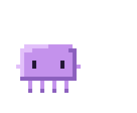
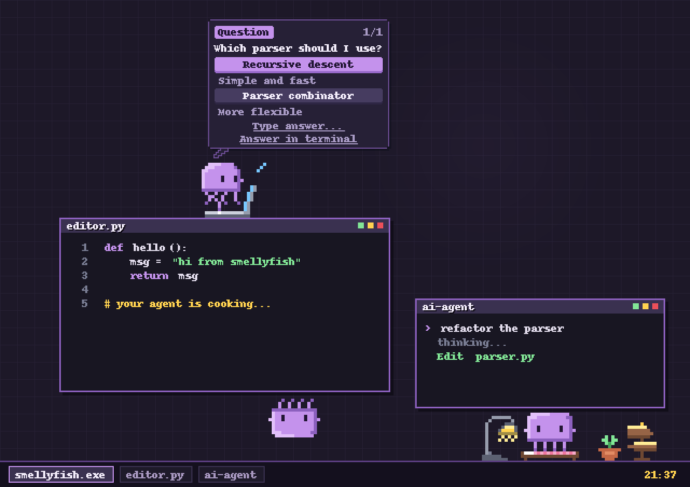
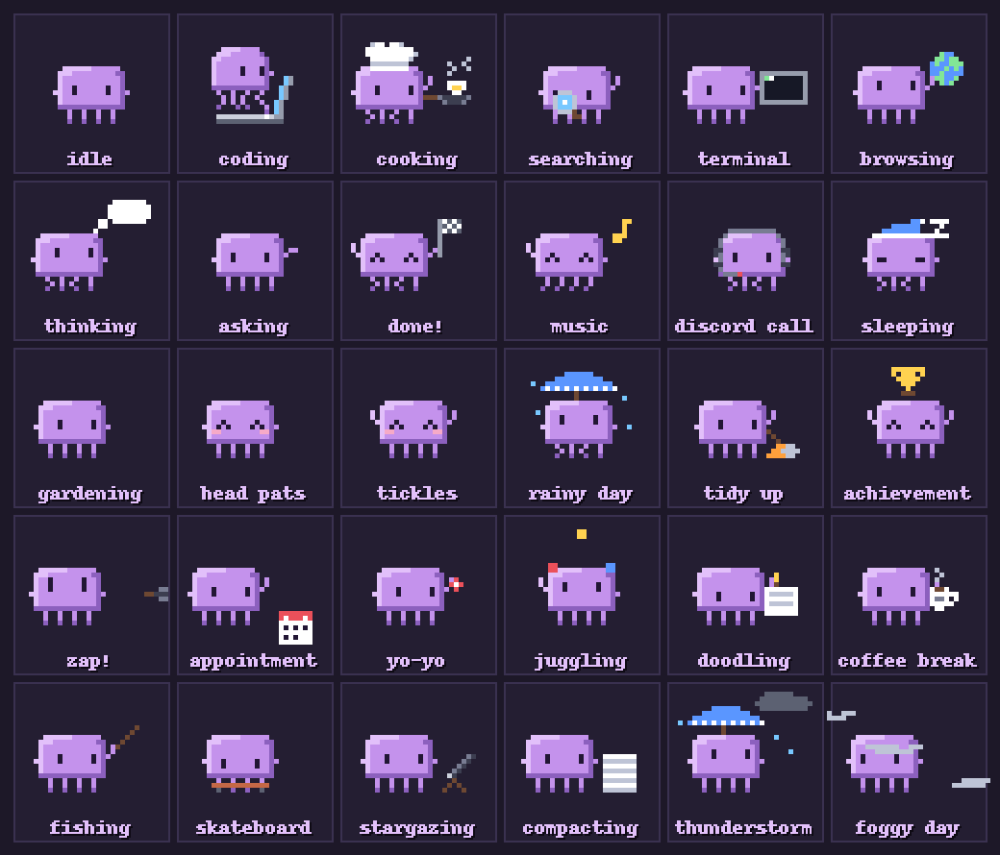
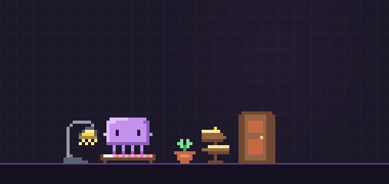
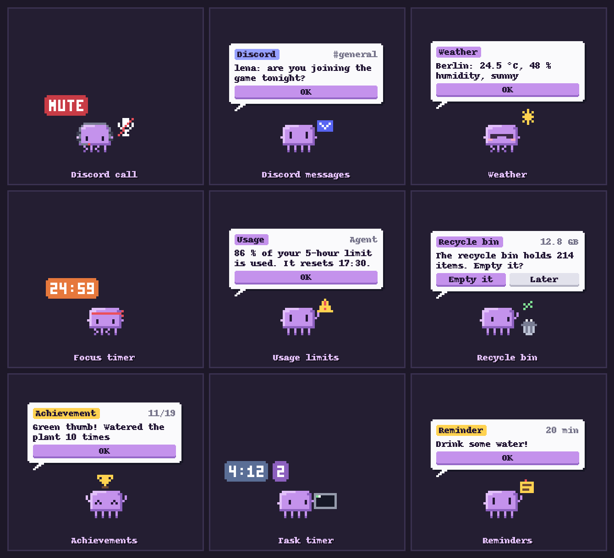
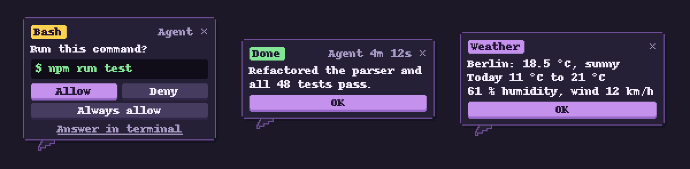

<div align="center">



# Smellyfish

**A tiny pixel-art jellyfish that lives on your Windows desktop<br>and keeps an eye on Claude Code, Codex and your PC.**

[](https://github.com/cweeperde/smellyfish-desktop-pet/releases/latest/download/Smellyfish.exe)

[](https://cweeperde.github.io/smellyfish-desktop-pet/)

</div>

<br>

<p align="center"></p>

## What it does

|  |  |
|---|---|
| **Lives on your desktop** | Sits on the top edge of your windows, hops between them, climbs window sides and floats back home to its little house with a lamp, a bed and a plant. Grab it and it dangles from a tentacle. |
| **Codes with you** | Pulls out a laptop while Claude Code or Codex works, grabs a magnifier when it searches, a terminal for commands, a globe for the web, and sometimes puts on a chef hat because your code is *cooking*. |
| **Answers from a bubble** | Questions and permission requests from Claude Code show up in a pixel speech bubble with buttons. Click to answer, or let it fall back to the terminal. |
| **Keeps you posted** | Task timer, a summary when a task is done, warnings when your usage limits run low, and a quiet badge for everything you missed in do-not-disturb. Timers and counters only show up when something changes or when you point at it. |
| **Knows your PC** | Sweats when the CPU is busy, dances to your music, wears a headset in Discord calls, gets a cartoon zap from the charger, reminds you of a full recycle bin and hides while you play fullscreen games. |
| **Just cute** | Pet its head, tickle its tentacles, throw it a ball, feed it a fish, check the weather at its plant, collect achievements. It also dangles upside down under windows now and then. |
| **Talks (optional)** | Chat with your own local Ollama or llama.cpp model. Short, cute answers in a speech bubble; the model loads when needed and unloads when idle. |
| **Visits (optional)** | Create a LAN lobby: friends step out of a door wearing their own look and hand over letters. Encrypted and limited to your network. |

<p align="center"></p>

## Friends and chat

<p align="center"></p>

Create a lobby on your network and friends can join with a password. Their jellyfish steps out of a door in its own colors and outfit and can hand over a letter. There is also an optional chat with your own local Ollama or llama.cpp model. Everything comes in a dark and a light look.

## Little helpers

<p align="center"></p>

<p align="center"></p>

## Download

1. Grab **[`Smellyfish.exe`](https://github.com/cweeperde/smellyfish-desktop-pet/releases/latest/download/Smellyfish.exe)** (always the latest version; older ones are in the [releases](https://github.com/cweeperde/smellyfish-desktop-pet/releases)).
2. Run it. That's it: one portable file, nothing to install.
3. Right-click the jellyfish in the tray for settings. Claude Code and Codex integration can be switched on there.

New versions install themselves automatically (you can turn that off in the settings).

## Privacy & safety

Smellyfish is meant to be easy to trust, which is why the source is public.

- **Your sessions stay local.** It listens only on `127.0.0.1` for events from Claude Code and Codex, and none of that ever leaves your PC.
- **Nothing changes without asking.** Claude Code / Codex hooks and the optional status line are only written when you switch them on in the settings, and a backup of your config is made first. Switching them off removes exactly what was added.
- **Every failure is harmless.** If the app is closed or something goes wrong, Claude Code and Codex behave as if Smellyfish wasn't there.
- **The lobby is opt-in and local.** Nothing listens until you create or join a lobby. Traffic is password-protected and encrypted (X25519 + ChaCha20-Poly1305), rate-limited, and never leaves your network. The local chat only talks to your own PC or a private address.
- **Network use is minimal and optional.** Weather comes from [Open-Meteo](https://open-meteo.com) only when you enter a place. Updates are fetched from this repository's releases and checked against GitHub's SHA-256 digest. Discord features only talk to the Discord app on your own PC. The optional "Playing Smellyfish" status is switched on by default, can be turned off in the settings, and only shares short generic lines.
- **Your data stays yours.** Settings live in `%APPDATA%\Smellyfish`.

## Project layout

```
smellyfish/
  app.py              the pet: windows, animation player, physics, events
  art/                sprites and animations (pixel art as text), bubbles, house, sounds
  features/           focus timer, to-do list, achievements, toys
  integrations/       hook server and relay, Claude Code / Codex hooks, usage limits, Discord, weather
  system/             window edges, PC monitor, recycle bin, hotkeys, beat detection
  ui/                 settings and other windows
  updater.py          self-update from GitHub releases
tools/build_exe.py    how the release exe is built
```

## A note on AI

Parts of the code were written, modified or assisted by AI.

## License

Copyright © 2026 cweeper. All rights reserved. The code is public so you can read and review it; see [LICENSE](LICENSE) for what is and isn't allowed.

Smellyfish is an independent project and is not affiliated with Anthropic, OpenAI or Discord.
