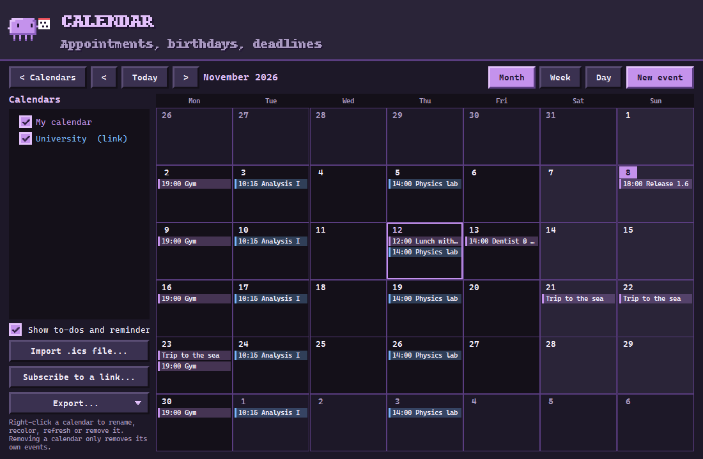
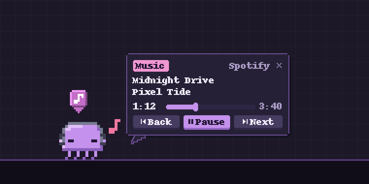
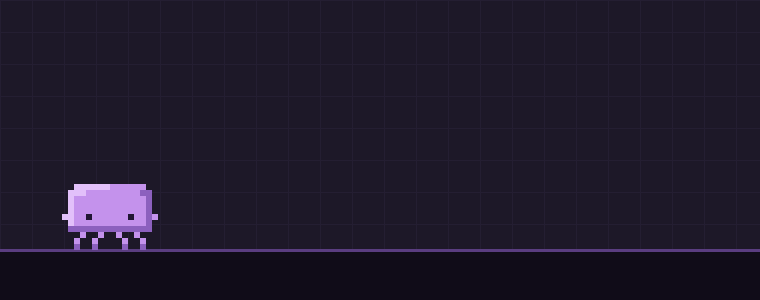
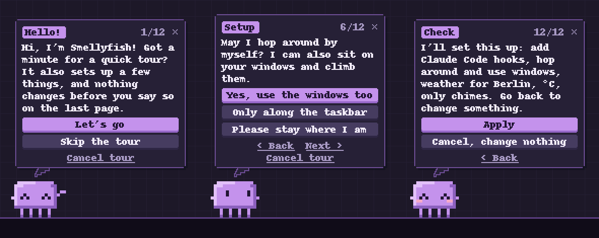

<div align="center">


# Smellyfish

**A pixel-art jellyfish that lives on your Windows desktop<br>and shows what Claude Code, Codex and your PC are doing.**

[](https://github.com/cweeperde/smellyfish-desktop-pet/releases/latest/download/Smellyfish.exe)

[](https://cweeperde.github.io/smellyfish-desktop-pet/)

</div>

<br>

<p align="center"></p>

Smellyfish sits on your windows, hops between them and goes to bed in its own little house. While Claude Code or Codex works, it pulls out a laptop; when they ask something, the question appears in a speech bubble you can answer with a click. It also keeps your calendar, shows what music is playing and reacts to what your PC is doing.

## What it does

|  |  |
|---|---|
| **On your desktop** | Sits on the top edge of windows, jumps between them, climbs their sides and hangs from a tentacle under them now and then. Its tentacles trail behind when it hops. Grab it and it dangles from your cursor. |
| **With your coding agent** | A laptop while Claude Code or Codex works, a magnifier when it searches, a terminal for commands, a globe for the web. Now and then it puts the laptop away for a short break, and a task timer shows how long the agent has been at it. |
| **In speech bubbles** | Questions and permission requests from Claude Code come with buttons. Click to answer, or close the bubble and answer in the terminal as usual. |
| **Calendar** | Month, week and day views, your own events, `.ics` import and subscribed links from Google, Outlook, iCloud or a university timetable. It reminds you before appointments. |
| **Music** | Spotify, a browser or any other player that reports to Windows: headphones on, a note in the badge, and play, pause and skip in a bubble. |
| **Your PC** | Sweats when the CPU is busy, wears a headset in Discord calls, gets a cartoon zap from the charger, points out a full recycle bin and hides during fullscreen games. |
| **Play** | Pet its head, tickle its tentacles, throw it a ball, feed it a fish, water its plant, collect achievements. |
| **Optional** | A chat with your own local Ollama or llama.cpp model, and a LAN lobby where friends visit and hand over letters. |

<p align="center"></p>

## Calendar

<p align="center"></p>

Your own calendar is always there. Imported `.ics` files become calendars you can edit; subscribed links are refreshed every hour and stay read-only. Removing a calendar removes only its own events. To-dos with a due time and reminders show up in the calendar too, and everything can be exported again as `.ics`, the to-do list also as Markdown or CSV.

## Music and movement

<p align="center"></p>

When music plays, it switches between dancing, bopping along and just carrying on with headphones. Click the note in the badge for the controls.

<p align="center"></p>

It contracts before a hop, its tentacles trail behind in the air and settle back into shape after the landing. Idle actions come at irregular times, it is livelier in the late morning than late at night, and it startles when you switch windows very fast.

## First start

<p align="center"></p>

The jellyfish explains the basics and asks a few questions: Claude Code hooks, which screen, whether it may roam, a home, weather, sounds and autostart. You can go back and forth, and nothing changes until you confirm on the last page. Right-click > More > Show the tour plays it again.

## More helpers

<p align="center"></p>

<p align="center"></p>

## Download

1. Download [`Smellyfish.exe`](https://github.com/cweeperde/smellyfish-desktop-pet/releases/latest/download/Smellyfish.exe). The link always points to the latest version; older ones are in the [releases](https://github.com/cweeperde/smellyfish-desktop-pet/releases).
2. Run it. It is a single portable file, there is nothing to install.
3. Follow the short tour. Later, right-click the jellyfish or its tray icon for the menu and the settings.

New versions install themselves; you can turn that off in the settings.

## Privacy & safety

The source is public so you can check what the program does.

- Events from Claude Code and Codex arrive on `127.0.0.1` only and never leave your PC.
- Hooks and the optional status line are written only after you agree, in the tour or in the settings. A backup of your config is made first, and switching them off removes exactly what was added.
- If Smellyfish is closed or something goes wrong, Claude Code and Codex behave as if it were not installed.
- The lobby is off until you create or join one. Its traffic is password-protected, encrypted (X25519 + ChaCha20-Poly1305), rate-limited and stays on your network. The local chat only talks to your own PC or a private address.
- Weather comes from [Open-Meteo](https://open-meteo.com) and only when you enter a place. Updates come from this repository's releases and are checked against GitHub's SHA-256 digest.
- A subscribed calendar is downloaded about once an hour from the link you entered; nothing is sent to it. Imported and local calendars stay in `%APPDATA%\Smellyfish\calendars`.
- Song titles and controls come from the Windows media controls. Smellyfish does not contact Spotify or any other service.
- Discord features talk only to the Discord app on your PC. The "Playing Smellyfish" status is on by default, shares only short generic lines and can be switched off.
- The About window asks `api.github.com` for the contributor list and loads their pictures from `avatars.githubusercontent.com`, only while it is open. Nothing is saved.
- Settings are stored in `%APPDATA%\Smellyfish`.

## Project layout

```
smellyfish/
  app.py              the pet: windows, animation player, physics, bubbles, menu, events
  settings.py         settings file with merge-save and backups
  changelog.py        release notes shown in the app
  updater.py          self-update from GitHub releases
  art/                sprites and animations as text rasters, simulated tentacles, bubbles, house, sounds
  features/           calendar, to-dos and exports, first-start tour, mood and timing, focus timer,
                      achievements, toys, lobby visitors
  integrations/       hook server and relay, Claude Code / Codex hooks, usage limits, Discord,
                      media controls, weather, local chat, LAN lobby
  system/             window edges, foreground window, PC monitor, recycle bin, hotkeys, beat detection,
                      click counter
  ui/                 settings, calendar, to-do, animation tester, lobby, chat, about and other windows
tools/build_exe.py    how the release exe is built
```

## A note on AI

Parts of the code were written, modified or assisted by AI.

## Contributing

Pull requests with fixes, ideas and new features are welcome. Please open an issue first for bigger changes. By submitting a pull request you agree to section 4 of the [license](LICENSE): you keep your copyright, grant the project the right to use your contribution, and your GitHub name and picture may appear in the app's About window.

## License

Copyright © 2026 cweeper. All rights reserved. The code is public so you can read and review it; see [LICENSE](LICENSE) for what is and isn't allowed. Open-source libraries used by the program (Qt for Python under the LGPL-3.0, Pillow, NumPy and others) stay under their own licenses, see [THIRD_PARTY_NOTICES.txt](THIRD_PARTY_NOTICES.txt) or the About window.

Smellyfish is an independent project and is not affiliated with Anthropic, OpenAI or Discord.
